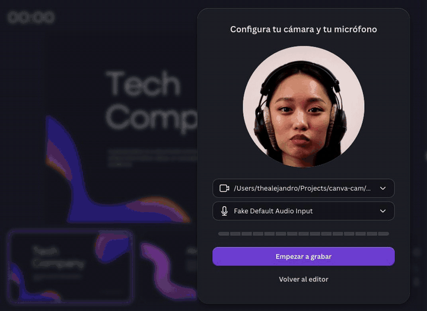

# canva-cam

**Graba una presentación de Canva usando un video ya grabado como cámara y su audio como micrófono. Sin OBS ni drivers de cámara virtual.**

[English](README.md)



**Presentar y grabar** de Canva solo acepta una cámara en vivo. Si quien presenta no puede estar (o quieres una toma limpia), canva-cam le pasa a Chrome un archivo de video como cámara y su audio como micrófono. Tú solo pasas las diapositivas mientras suena la grabación.

## Requisitos

- macOS con Google Chrome
- [ffmpeg](https://ffmpeg.org) (`brew install ffmpeg`, o un binario estático en `bin/ffmpeg`)

## Uso

1. **Preparar el video** (una vez por video, ~1 min):

   ```bash
   ./prepare.sh ~/Downloads/video.mov
   ```

   Genera `media/cam.mjpeg` y `media/mic.wav` con 5 s de margen al inicio y abre `media/preview.png` con el círculo de Canva. Si la cara no queda centrada, pasa el desplazamiento del recorte en píxeles desde arriba (por defecto 100):

   ```bash
   ./prepare.sh ~/Downloads/video.mov 250
   ```

2. **Abrir Chrome:** doble clic en `record.command` (la primera vez, clic derecho → **Abrir**). Abre un Chrome aparte con su propio perfil en `chrome-profile/`; tu Chrome normal no se toca.

3. **Solo la primera vez, en esa ventana:** ve a `chrome://extensions`, activa **Modo de desarrollador** → **Cargar descomprimida** → elige la carpeta `raw-mic`. Luego inicia sesión en Canva.

4. **Grabar:** abre tu diseño → **Presentar y grabar**, elige la cámara y el micrófono `fake…` y **pulsa grabar enseguida**. El video empieza cuando Canva abre la cámara, no cuando empieza a grabar; los 5 s de margen cubren la cuenta atrás de 3 s. Puedes cambiarlo con `MARGIN=8 ./prepare.sh …`.

5. **Repetir:** el audio suena una sola vez. Cierra esa ventana de Chrome (Cmd+Q) y vuelve a abrir `record.command`.

## Cómo funciona

Chrome tiene flags de prueba que sustituyen la cámara y el micrófono por archivos. Los detalles de cada problema (audio entrecortado, voz distorsionada por el procesado de Chrome, extensión que ya no se carga por flag…) y cómo se resolvió cada uno están en la [tabla del README en inglés](README.md#how-it-works-and-the-gotchas).

**Brave no funciona bien:** casi no lee el MJPEG (el video se congela) y con Y4M el video va ~0.9 s detrás del audio.

## Notas

- Debería funcionar en cualquier web que use la cámara con `getUserMedia` (Meet, Loom…), pero solo se probó con Canva.
- Usa solo videos de personas que estén de acuerdo.
- Sin relación con Canva.
- Video de la demo: [ANTONI SHKRABA production en Pexels](https://www.pexels.com/video/woman-is-talking-while-looking-at-camera-8135207/).

## Licencia

[MIT](LICENSE)
