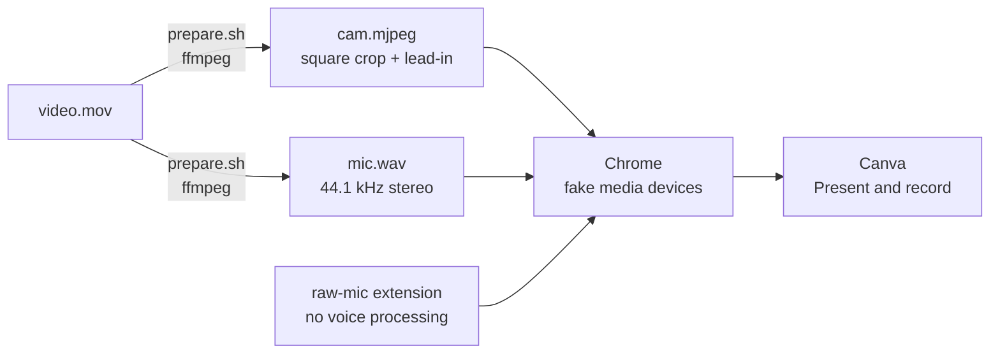

# canva-cam

**Record a Canva presentation with a pre-recorded video as your webcam and its audio as your mic. No OBS, no virtual camera drivers.**

[Español](README.es.md)


Canva's **Present and record** only takes a live camera. If the speaker can't be there (or you want a clean take), canva-cam feeds Chrome a video file as the camera and its audio as the microphone. You just advance the slides while the recording plays.



## Requirements

- macOS with Google Chrome, or Linux with Google Chrome or Chromium (`./record.command` from a terminal). Windows: not yet (#2).
- [ffmpeg](https://ffmpeg.org) (`brew install ffmpeg`, or a static build at `bin/ffmpeg`)

## Usage

**Easiest, no terminal:** double-click `canva-cam.command` (the first time, right-click → **Open**). It asks for the video, shows Canva's circle so you can move the face up or down, prepares the files and opens Chrome. Then continue at step 3. The steps below do the same from the terminal.

1. **Prepare the video** (once per video, ~1 min):

   ```bash
   ./prepare.sh ~/Downloads/video.mov
   ```

   It writes `media/cam.mjpeg` and `media/mic.wav` with a 5 s lead-in and opens `media/preview.png` showing Canva's circle. If the face isn't centered, pass the crop offset in pixels from the top (default 100):

   ```bash
   ./prepare.sh ~/Downloads/video.mov 250
   ```

2. **Open Chrome:** double-click `record.command` (the first time, right-click → **Open**). It opens a separate Chrome instance with its own profile in `chrome-profile/`; your normal Chrome stays untouched.

3. **First time only, in that window:** go to `chrome://extensions`, turn on **Developer mode** → **Load unpacked** → pick the `raw-mic` folder. Then sign in to Canva.

4. **Record:** open your design → **Present and record**, choose the `fake…` camera and microphone and **hit record right away**. The video starts when Canva opens the camera, not when recording starts; the 5 s lead-in covers Canva's 3 s countdown. Change it with `MARGIN=8 ./prepare.sh …`.

5. **Retake:** the audio plays once. Quit that Chrome window (Cmd+Q) and open `record.command` again.

## How it works (and the gotchas)

Chrome has testing flags that replace the camera and microphone with files: `--use-fake-device-for-media-stream`, `--use-file-for-fake-video-capture` and `--use-file-for-fake-audio-capture`. Getting a usable recording out of them took a few fixes:

| Problem | Cause | Fix |
|---|---|---|
| No audio at all | The audio service sandbox can't read the WAV | `--disable-features=AudioServiceSandbox` (narrower than `--no-sandbox`) |
| Choppy audio | Chrome's file reader stutters with 48 kHz mono | Encode the WAV as 44.1 kHz stereo |
| Distorted, "over-suppressed" voice | Chrome's voice processing (auto gain +13 dB, noise suppression) is applied to the already clean recording | `raw-mic` extension forces `echoCancellation`, `noiseSuppression` and `autoGainControl` off on every `getUserMedia` call |
| Extension can't be loaded by flag | Chrome 137+ ignores `--load-extension` | Load it once by hand; the profile remembers it |
| Face off-center in Canva's bubble | Vertical phone video | Square crop with an adjustable offset + preview with the circle mask |

Each fix was checked by recording what Chrome actually delivered (`MediaRecorder`) and comparing it with the source in ffmpeg: levels, spectrograms and frozen-frame detection.

**Brave doesn't work well:** it barely decodes the MJPEG (the video freezes) and with Y4M the video lags ~0.9 s behind the audio.

## Notes

- It should work on any site that uses the webcam through `getUserMedia` (Meet, Loom…), but it was only tested with Canva.
- Last tested on macOS 15.8.1 (Intel) with Chrome 155.0.8059.86. `record.command` prints the Chrome version it launches; include it when reporting a problem.
- CI (GitHub Actions) checks the scripts and runs `prepare.sh` on Linux with synthetic videos, with and without audio, on every PR.
- Only use videos of people who agreed to it.
- Not affiliated with Canva.
- Demo video by [ANTONI SHKRABA production on Pexels](https://www.pexels.com/video/woman-is-talking-while-looking-at-camera-8135207/).

## License

[MIT](LICENSE)
